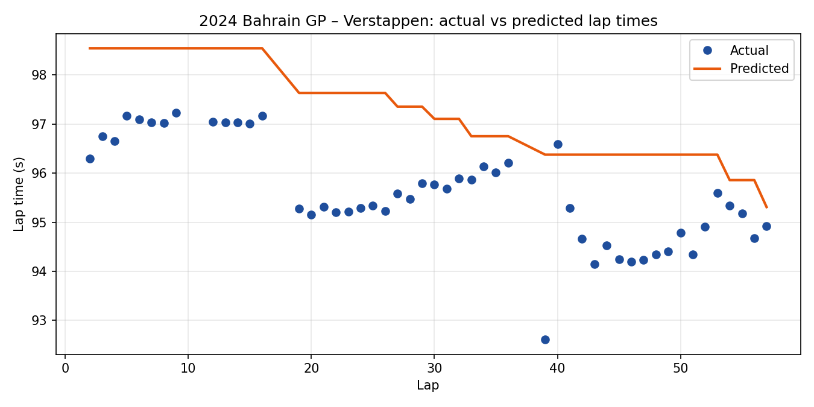

# F1 Lap Time Prediction

Predicting Formula 1 race lap times from tyre and race-state data, using every race of the 2022–2024 seasons.

The model is trained on 2022–2023 and evaluated on the full 2024 season, so it is tested on races it has never seen.

## Results

| Metric | Value (2024 test season) |
| --- | --- |
| MAE | **2.78 s** (~3% of a typical lap) |
| RMSE | 3.92 s |
| Baseline MAE (circuit's average lap time) | 3.40 s |
| Improvement over baseline | **18%** |
| Training laps | 38,826 |
| Test laps | 22,978 |

Data covers 61,800+ clean laps across 25 circuits and 28 drivers.



The model follows the race's shape (pace improving as tyres are changed and fuel burns off) but predicts laps consistently slower than reality. The cars were faster in 2024 than in the 2022–2023 training seasons, and the model has no way to account for that yet; see [Next steps](#next-steps).

## How it works

**1. Data collection** — [src/data/pull_data.py](src/data/pull_data.py)
Pulls lap-by-lap timing for every race in a season through the [FastF1](https://github.com/theOehrly/Fast-F1) API, tagging each lap with season, event, round and circuit.

**2. Red flag detection** — [src/data/race_events.py](src/data/race_events.py)
Laps right after a red-flag restart are abnormally slow but are still marked as green-flag laps in the data. The pipeline reads the track-status timeline, finds the moment each red flag ends, and flags each driver's first two laps after the restart.
The rule was validated against 10 red-flagged races in [notebooks/validate_red_flag.py](notebooks/validate_red_flag.py), comparing each removed lap against that driver's median pace. Removing these laps reduced model error.

**3. Cleaning** — [src/data/clean_data.py](src/data/clean_data.py)
Keeps only representative racing laps by removing:
- laps under safety car, virtual safety car or yellow flags
- pit-in and pit-out laps
- the opening lap
- red-flag restart laps
- laps with missing time, tyre or driver data

**4. Model** — [src/models/GradientBoosting.py](src/models/GradientBoosting.py)
A scikit-learn `GradientBoostingRegressor` predicting lap time in seconds from:

| Feature | Type |
| --- | --- |
| Tyre life (laps) | numeric |
| Lap number | numeric |
| Stint | numeric |
| Tyre compound | categorical (one-hot) |
| Driver | categorical (one-hot) |
| Circuit | categorical (one-hot) |

After training, the script compares the model against a simple baseline, breaks error down by circuit and by compound, and lists the worst predictions, which is how weak spots (such as circuits absent from the training seasons) were found.

## Project structure

```
src/
  main.py                 # pulls + cleans 2022–2024 and saves the dataset
  data/
    pull_data.py          # FastF1 data download
    race_events.py        # red flag detection
    clean_data.py         # lap filtering
  models/
    GradientBoosting.py   # training and evaluation
notebooks/
  validate_red_flag.py    # checks the red flag rule on real races
  exploration/            # early scripts used to investigate the data
images/                   # charts generated by the model script
```

## Running it

Tested on Python 3.13.

```bash
pip install -r requirements.txt

# 1. Download and clean 2022–2024 race data (slow the first time; FastF1 caches it)
python src/main.py

# 2. Train and evaluate the model
python src/models/GradientBoosting.py
```

## Next steps

- Account for car performance improving from season to season (e.g. use each team's pace in earlier 2024 races)
- Add weather and track temperature as features
- Account for fuel load and track evolution over a race
- Compare against other models (e.g. XGBoost, LightGBM)
- Predict full race strategy outcomes from lap-level predictions
